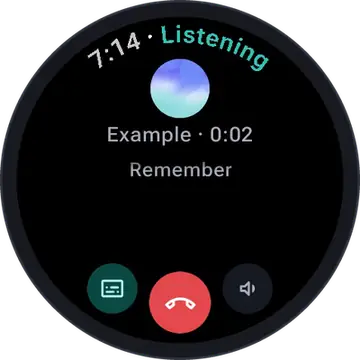
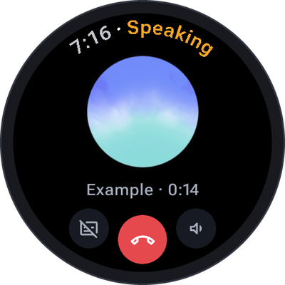
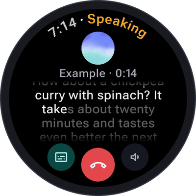
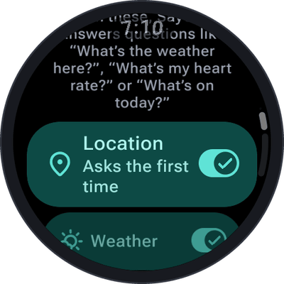
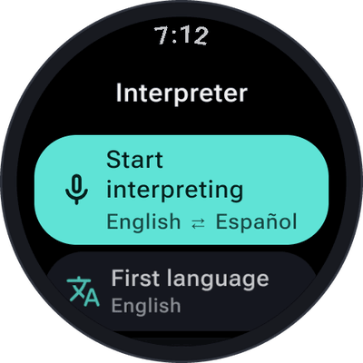
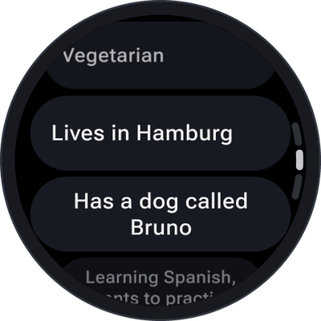

# SayOVA

### Orb Voice Assistant – talk to AI from your wrist.

A realtime voice assistant for Wear OS: speak naturally, interrupt whenever you like,
hear the answer and read it along on your watch — with Google Gemini or OpenAI and your own API key.

  
  
  
  
  
  

  
  
  
  

---

## 🎬 See it in action

<table>
  <tr>
    <td width="380" align="center">
      
    </td>
    <td valign="middle">
      <h3>Just talk.</h3>
      Tap the orb and ask — no commands to learn, no wake word, no waiting for a beep. SayOVA streams
      your voice live to a speech-to-speech model and answers as it thinks, in a natural voice.
      Talk over it to interrupt, show the transcript with one tap, and let it set the timer, check the
      weather or put a message on your phone while you keep talking.
        
      <i>The sample conversation above plays right on the watch when you first open SayOVA — in
      your language, without a key and without network.</i>
    </td>
  </tr>
</table>

 

## 📸 Screenshots

<table>
  <tr>
    <td align="center"></td>
    <td align="center"></td>
    <td align="center"></td>
    <td align="center"></td>
  </tr>
  <tr>
    <td align="center"></td>
    <td align="center"></td>
    <td align="center"></td>
    <td align="center"></td>
  </tr>
</table>

 

## 📲 Installation

**SayOVA is available on
[Google Play](https://play.google.com/store/apps/details?id=net.devemperor.sayova&referrer=utm_source%3Dgithub%26utm_medium%3Dintro%26utm_campaign%3Dreadme)**
as a one-time purchase, with free updates. Install it from the Play Store on your watch, or from the
Play Store on your phone and pick the watch as the device.

What you need:

- a **Wear OS 3+ watch with a microphone** (Galaxy Watch, Pixel Watch, TicWatch, …)
- an **API key** from [Google AI Studio](https://aistudio.google.com/apikey) (recommended) or
  [OpenAI](https://platform.openai.com/api-keys) — see [Getting an API key](#-getting-an-api-key)
- a phone with a camera for the one-time pairing (any phone; no companion app)

📖 **Every function, step by step and with pictures, is in the
[SayOVA guide](https://github.com/DevEmperor/SayOVA/wiki)** — also on the watch under
*Settings → Help & guide*.

 

## ✨ What is SayOVA?

**SayOVA** turns your watch into a real conversation partner. Instead of dictating a command and
reading a card, you simply talk: ask a follow-up, change your mind halfway, cut the answer short.
SayOVA hears you while it speaks, keeps the conversation's context, and uses the watch it runs on —
its timers and alarms, your location, the weather, your heart rate, your calendar, your phone — only
when your question needs it.

It runs on **your own API key**. Your voice goes straight from the watch to the provider you chose;
there is no SayOVA server in between, no account, and no subscription. A conversation with Gemini
costs about a cent a minute, and SayOVA shows you exactly what you spend.

 

## 🎤 Features

### Conversation

- **Real conversations, not commands.** SayOVA streams your voice live to a speech-to-speech model
  (Gemini Live or OpenAI Realtime) and plays the answer as it is generated. Speak over it to
  interrupt, or tap the orb.
- **Live transcript, one tap away.** By default SayOVA shows only its orb, pulsing with whoever
  speaks. Tap the text button and both sides appear as you talk; the part of an answer you have
  already heard is bright, the rest still dim. SayOVA remembers your choice.
- **Its own volume, and quiet at a tap.** Turn the bezel or crown to set SayOVA's volume; it is
  remembered, and your media volume is handed back when the conversation ends. The sound button
  switches the voice off for quiet places, and the transcript shows instead.
- **Pick up where you left off.** Continue any conversation from the history; SayOVA remembers what
  was said.
- **Remembers what you ask it to.** Say *"Remember that I'm vegetarian"* and every later
  conversation knows. Only what you ask for is kept, on the watch, and the settings list every fact
  to read or delete.
- **Personalities** that also set how long SayOVA talks — Friendly, Concise, Detailed, Tutor,
  Language partner or your own instruction — and **40 voices** to listen to before you pick one.
- **Speaks your language.** The app is translated into 12 languages besides English, and SayOVA
  answers in whatever language you talk to it.

### On the watch

- **Timers, alarms and notes.** Timers, alarms (also every weekday), notes, battery and time —
  *"show my timers"* opens the clock to stop one or turn an alarm off.
- **Web search** for anything current.
- **Knows the watch it runs on – when you ask.** *"What's the weather here?"*, *"What's my heart
  rate?"*, *"How many steps today?"*, *"What's on this afternoon?"*, *"When does my alarm ring?"*,
  *"How high up am I?"*, *"Pause the music"*, *"Call Lena"*, *"Open the flashlight"*, *"Anything
  new?"*: SayOVA uses the location, weather, heart rate, steps, calendar, air pressure, next alarm,
  music, contacts, apps or notifications only for that question, after you allowed it once, and
  shows an icon while it does. Each one can be switched off under *Settings → Watch features*. Calls
  are placed only after you confirmed name and number.
- **Prepares things on your phone.** *"Text Lena on WhatsApp that I'm ten minutes late"*, *"Put the
  dentist on Tuesday at three in my calendar"*, *"Route to the station on foot"*: SayOVA reads the
  message back, and after your yes it waits on your phone — in WhatsApp, your messages or mail app,
  your own calendar app or your maps app — for you to send, add or start. SayOVA itself never sends
  anything in your name.
- **Interpreter.** Hold the watch between two people: SayOVA says everything in the other language
  (21 languages, the pair is remembered) and shows both sides as text.

### Made for the wrist

- **Tile, complication and watch-face shortcut.** Start a conversation with one tap; the
  complication slots with a value show the month's cost against your budget.
- **Faster starts.** Put SayOVA on a double press of the watch's button and turn on *Talk when
  opened* — a double press, and it listens.
- **Fast connection.** Wi-Fi or LTE is used during a conversation instead of the slow Bluetooth
  link; conversations continue with the screen off.
- **Push-to-talk** keeps the microphone closed until you tap, and **End after silence** hangs up for
  you.
- **History on the watch only**, kept as long as you like, never backed up to the cloud. Send a
  conversation (or several) to your phone as text, to share it with any app or copy it.

### Cost and privacy

- **Know what it costs.** A running estimate during the conversation; cost and talk time per day,
  month and in total; a monthly budget that warns at 80%, can switch to the Fast model from there,
  and asks before every conversation once it is spent.
- **Your provider, your key, your data.** Audio goes straight from the watch to Google or OpenAI.
  Your key is encrypted on the watch with a key that never leaves its secure hardware.
- **Easy, secure setup.** Scan a QR code on the watch, paste your key on your phone, and it arrives
  end-to-end encrypted. No companion app, no typing on a tiny keyboard.
- **Hear it before you set it up.** The welcome page plays a sample conversation in your language,
  both sides spoken, with no key and no network; a short tour then points out the controls.

<i>Bring your own API key — SayOVA works with:</i>

  
  

 

## 🔑 Getting an API key

**Google Gemini (recommended)**

1. Sign in to [Google AI Studio](https://aistudio.google.com/apikey) and choose
   **Create API key**.
2. In the EU, the UK and Switzerland, turn on billing (*Projects → Set up billing*).
   Prepaying $5 lasts for many hours of talking, and on the paid tier Google does not
   use your conversations to improve its products.
3. Optional: set a monthly limit under *Spend*.

**OpenAI**

1. Create a key on the [OpenAI platform](https://platform.openai.com/api-keys).
2. Make sure the account has credit.

Then open SayOVA on the watch, choose the provider, scan the QR code with your phone and paste the
key on the page that opens. The [setup guide](https://github.com/DevEmperor/SayOVA/wiki/Getting-started)
walks through it with pictures.

 

## 💸 What it costs

SayOVA is a one-time purchase on Google Play. Talking is billed by your provider, at
its own prices — roughly:

| Provider | Model in SayOVA | Approximate cost |
| --- | --- | --- |
| Google | `gemini-3.8-live` (Fast), `gemini-3.8-live-extended-thinking` (Thorough) | 1–2 ¢ per minute |
| OpenAI | `gpt-realtime-2.1-mini` (Fast) | 2–5 ¢ per minute |
| OpenAI | `gpt-realtime-2.1` (Best) | 6–11 ¢ per minute |

SayOVA shows a running estimate during the conversation and the month's total in the settings. A
monthly budget (*Settings → Monthly budget*, $1 to $50) warns from 80% on, can switch to the Fast
model from there, and asks before every conversation once it is spent. Thorough answers at once and
then thinks in the background before it gives its considered answer; that thinking adds about half a
cent to a hard question.

 

## 🔒 Privacy

Your voice and your conversations go only to the provider you chose. Your key is encrypted on the
watch, the history and memory never leave it except inside a conversation with your provider, and
the pairing relay only ever sees data it cannot read. For the weather, MET Norway receives the
place's rounded coordinates. No analytics, no ads, no tracking.

Details: [PRIVACY_POLICY.md](PRIVACY_POLICY.md).

 

## 🤝 Contributing

The best way to help is to **[open an issue](https://github.com/DevEmperor/SayOVA/issues)** with bug
reports, ideas or feedback. A wrong or offensive answer can be reported right from the watch: open
the conversation in the history and choose *Report a response*.

 

## 📄 License & credits

SayOVA is released under the [Apache License 2.0](LICENSE); see [NOTICE](NOTICE) for attributions.

- The orb is adapted from the Cloud theme of [orb-ui](https://github.com/exprmntl/orb-ui) by
  Alexander Chen (MIT License), recoloured in SayOVA's palette.
- Weather data from [MET Norway](https://api.met.no) (CC BY 4.0).
- Icons: [Material Symbols](https://fonts.google.com/icons) (Apache License 2.0).

 

## ❤️ Support

SayOVA is built in my spare time. If it makes your day a little easier, you can support development by
[buying the app on Google Play](https://play.google.com/store/apps/details?id=net.devemperor.sayova&referrer=utm_source%3Dgithub%26utm_medium%3Dsupport%26utm_campaign%3Dreadme),
[sponsoring me on GitHub](https://github.com/sponsors/DevEmperor)
or [donating via PayPal](https://paypal.me/DevEmperor). Thank you! 🙏

Questions? [contact@devemperor.net](mailto:contact@devemperor.net)
