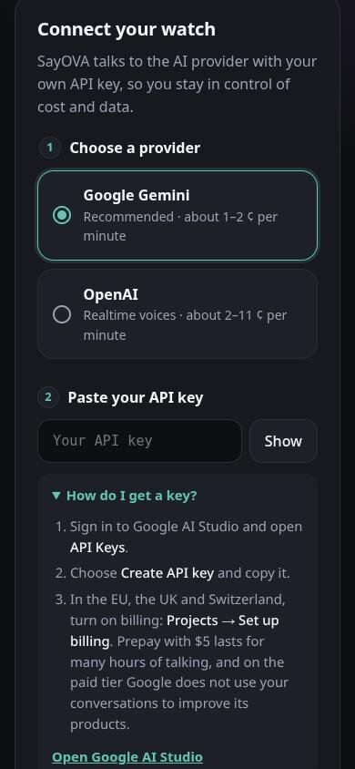
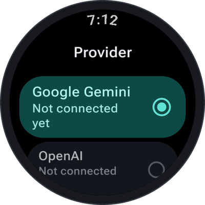
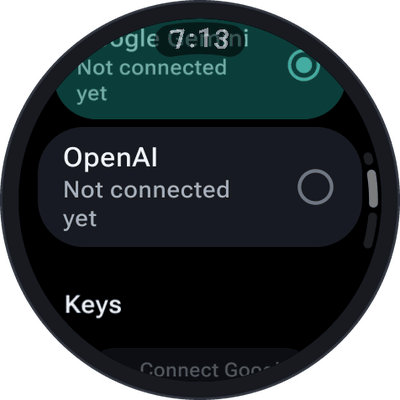

# API keys

SayOVA talks to the AI with **your own API key**. That is why there is no subscription and no SayOVA
server: you pay your provider directly for what you use — usually a cent or two a minute — and your
conversations go straight to them. This page shows how to get a key, how to hand it to the watch and how
to manage it later.

## Which provider?

| | Google Gemini | OpenAI |
| --- | --- | --- |
| **Recommended for** | Most people: cheapest, natural, fast | OpenAI's voices and models |
| **Models in SayOVA** | *Fast* (`gemini-3.8-live`), *Thorough* (`gemini-3.8-live-extended-thinking`) | *Fast* (`gpt-realtime-2.1-mini`), *Best* (`gpt-realtime-2.1`) |
| **Approximate cost** | 1–2 ¢ per minute | 2–5 ¢ (Fast) or 6–11 ¢ (Best) per minute |
| **Voices** | 30 | 10 |
| **Get a key** | [Google AI Studio](https://aistudio.google.com/apikey) | [OpenAI platform](https://platform.openai.com/api-keys) |

You can connect both and switch between them at any time; each keeps its own model and voice.

## Getting a Google Gemini key

1. Sign in to [Google AI Studio](https://aistudio.google.com/apikey) with your Google account and open
   **API Keys**.
2. Choose **Create API key** and copy it.
3. **In the EU, the UK and Switzerland, turn on billing:** *Projects → Set up billing*. Prepaying $5
   lasts for many hours of talking, and on the paid tier Google does **not** use your conversations to
   improve its products.
4. Optional but recommended: set a monthly spending limit under *Spend*, as a second safety net next
   to SayOVA's own [budget](Costs-and-budget).

Without billing, Google's terms for its free tier allow it to use what you send to improve its
products. With SayOVA that is your voice, so billing is worth turning on wherever you are.

 

## Getting an OpenAI key

1. Sign in to the [OpenAI platform](https://platform.openai.com/api-keys) and open **API keys**.
2. Choose **Create new secret key** and copy it.
3. Make sure your account has credit under **Billing**. OpenAI's API is prepaid: without credit, the key
   is accepted but every conversation ends with *No credit left*.

## Handing the key to the watch

You never type a key on the watch. Instead:

1. On the watch, choose the provider. A **QR code** appears.
2. Scan it with your phone's camera (or tap **On phone** to open the page on the paired phone).
3. Paste the key on the page and tap **Send to watch**.
4. Check that the watch and the page show the **same code**, and tap the check mark on the watch.
5. SayOVA checks the key with the provider and shows **Connected**.

The key is **encrypted in your phone's browser** with a key that only this watch holds, before it
leaves the phone. The relay in between (`pair.sayova.app`) only passes on data it cannot read and
deletes it after ten minutes at the latest. On the watch the key is encrypted again, with a key kept in
the watch's secure hardware that cannot be copied off it. [Getting started](Getting-started#4-choose-a-provider-and-connect-your-key)
shows these steps with pictures.

## Managing keys: Settings → Provider

<table>
  <tr>
    <td align="center" width="50%"></td>
    <td align="center" width="50%"></td>
  </tr>
</table>

The first line of the [settings](Settings) shows the provider and whether its key is on the watch. Tap it to:

- **Switch the provider** — tap Google Gemini or OpenAI. A provider without a key asks you to connect one.
- **Connect a key** for a provider that has none yet.
- **New key for …** — replace a key, for example after you revoked the old one.
- **Remove … key** — deletes the key from the watch.

Each connected provider shows the last characters of its key (*Key …a1B2*), so you can tell which one is
on the watch.

> **Important:** removing a key from the watch does not revoke it. If you think a key got into the wrong hands, delete
> it at [Google AI Studio](https://aistudio.google.com/apikey) or on the
> [OpenAI platform](https://platform.openai.com/api-keys) and connect a new one.

## When the key stops working

| Message on the watch | What it means | What to do |
| --- | --- | --- |
| **Key not accepted** | The provider rejected the key: deleted, revoked or mistyped. | Tap **Connect** and hand over a new key. |
| **No credit left** | The account has no credit, no billing set up, or reached its spending limit. | Top up or raise the limit at your provider. |
| **Too many requests** | The provider asks to slow down (rate limit). | Try again in a minute. |

More in [Troubleshooting](Troubleshooting).
