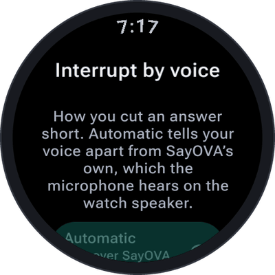
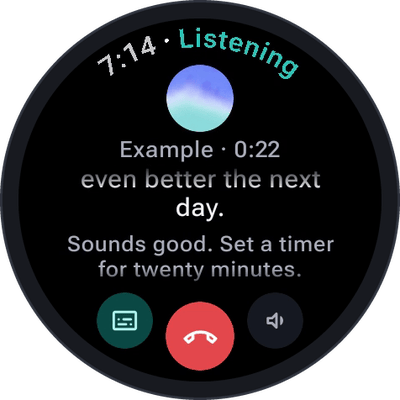

# Conversations

A conversation with SayOVA works like a phone call: you start it, talk back and forth as long as you
like, and hang up. There are no commands to learn and no wake word — just speak.

## Starting a conversation

- **Talk** on the home screen, or a tap on the home screen's orb.
- The **tile** — swipe from the watch face to SayOVA's tile and tap **Talk**.
- A **complication** on your watch face.
- A **double press of the watch's button**, with *Talk when opened* on.

[Tile, complication and shortcuts](Tile-complication-and-shortcuts) shows how to set each one up.

SayOVA listens **from the moment you tap**, even while it is still connecting — you can start talking
straight away, nothing you say is lost. The home screen also wakes the watch's Wi-Fi while it is shown,
so the connection is usually ready by the time you tap.

## The conversation screen

<table>
  <tr>
    <td align="center" width="50%"></td>
    <td valign="middle">
      <b>At the top</b> — the time and what SayOVA is doing, in its colour.  
      <b>The orb</b> — moves with whoever is speaking: with your voice while you talk, with SayOVA's while it answers.  
      <b>Under the orb</b> — how long the conversation runs, its cost (with <i>Show cost</i> on) and the network: <i>Wi-Fi</i>, <i>LTE</i> or <i>via phone</i>. While a watch feature is in use, its icon appears in front.  
      <b>At the bottom</b> — text on/off, hang up, sound.
    </td>
  </tr>
</table>

### What the status means

| Status | Meaning |
| --- | --- |
| **Connecting** | SayOVA is reaching your provider. You can already talk. |
| **Listening** | Your turn. Just speak. |
| **Thinking** | Your provider is working on the answer — or, with the *Thorough* model, still thinking in the background after its first words. |
| **Speaking** | SayOVA answers. Talk over it to interrupt. |
| **Muted** | You muted the microphone with a tap on the orb. Tap again to talk. |
| **Tap to talk** | Push-to-talk is on: tap the orb, speak, tap again. |
| **Reconnecting** | The connection dropped and SayOVA is getting it back. The conversation continues. |
| **Saved** | The conversation has ended and is in the [history](History). |
| **Ended** | The conversation has ended without being saved (history is off). |
| **Problem** | Something went wrong; the screen says what and offers a way out. See [Troubleshooting](Troubleshooting). |

## Interrupting

Don't wait for SayOVA to finish. **Just start talking** and it stops and listens — exactly like
interrupting a person. Or **tap the orb** while it speaks.

On the watch's own speaker, the microphone also hears SayOVA. SayOVA tells your voice apart from its
own, so its answer does not interrupt itself. How it does that is set under
**Settings → Interrupt by voice**:

 

| Setting | When to use it |
| --- | --- |
| **Automatic** (default) | Talk over SayOVA to interrupt it. Works on the watch speaker. |
| **Open microphone** | For headphones: the microphone stays fully open. On the speaker, SayOVA may interrupt itself. |
| **Tap only** | Only a tap on the orb interrupts. For loud places, or if SayOVA keeps stopping by itself. |

## Reading along: the transcript

<table>
  <tr>
    <td align="center" width="33%"></td>
    <td align="center" width="33%"></td>
    <td align="center" width="33%"></td>
  </tr>
</table>

By default SayOVA shows only its orb. Tap the **text button** (bottom left) and both sides of the
conversation appear as you talk. The part of an answer you have already **heard is bright**, the rest
is still dim — so you can read ahead or see where SayOVA was when you interrupted. Tap again to hide it.
SayOVA remembers your choice for the next conversation.

When SayOVA does something — sets a timer, saves a note, checks the weather — a **short note** appears
under the orb (*Timer · 20 min*) and stays in the transcript with a check mark (✓ *Timer · 20 min*).
Notes you asked to save are marked with ✎.

## Volume and sound

- **Turn the bezel or the crown** during a conversation to set SayOVA's volume. SayOVA has its own
  volume, remembered between conversations; your media volume is handed back when the conversation ends.
- **Hold the sound button** (bottom right) for volume buttons, if your watch has no bezel or crown.
- **Tap the sound button** to switch SayOVA's voice off — for meetings, trains, the library. The answer
  then appears as text, and the transcript is shown. Tap again for sound.

## Muting the microphone and push-to-talk

- While SayOVA listens, a **tap on the orb mutes** the microphone (*Muted*). Tap again to talk.
- With **Settings → Push to talk** on, the microphone stays closed until you need it: **tap the orb,
  speak, tap again** (*Tap to talk*). Good for noisy places, or when you want to think before you speak.

## Ending a conversation

- Tap the **red button**, or say goodbye — *"Thanks, that's all"* — and SayOVA hangs up by itself.
- With **Settings → End after silence** (10, 20, 30 or 60 seconds, or never), SayOVA hangs up when
  nobody has said anything for that long. Default: 20 seconds.
- Conversations go to the [history](History), where you can read them, continue them or send them to your phone.

You don't have to keep the screen on: **a conversation continues with the screen off**, and the watch
shows it as an ongoing activity on the watch face. Tap that to come back.

## Continuing later

Open a conversation in the [history](History) and tap **Continue**: SayOVA picks up where you left off
and remembers what was said.

## The connection

SayOVA uses **Wi-Fi or LTE** for a conversation, not the slow Bluetooth link through your phone — a
realtime voice conversation needs it. If neither is available, it talks through the phone (*via phone*),
which works but may lag. On a weak connection SayOVA reconnects by itself (*Reconnecting*) and carries on.

## Things to ask

| Ask … | SayOVA … |
| --- | --- |
| *"How long do I boil an egg for a runny yolk?"* | answers from what the model knows |
| *"What's the latest on the Artemis mission?"* | [searches the web](Timers-alarms-and-notes#web-search) |
| *"Set a timer for 12 minutes for the pasta."* | [sets a timer](Timers-alarms-and-notes) |
| *"What's the weather tomorrow in Munich?"* | [checks the weather](Watch-features#weather) |
| *"How's my heart rate?"* | [measures it](Watch-features#heart-rate) |
| *"Text Lena on WhatsApp that I'm late."* | [prepares the message on your phone](Prepare-on-phone) |
| *"Remember that my sister's birthday is on 3 May."* | [remembers it](Memory) |
| *"Talk to me only in Spanish, I want to practise."* | switches language — or try the *Language partner* [personality](Settings#personality) |
| *"Bye!"* | hangs up |
