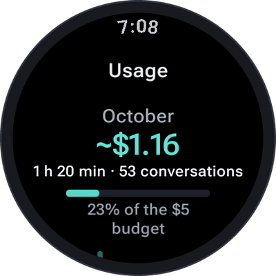
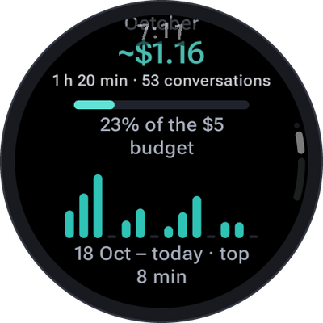
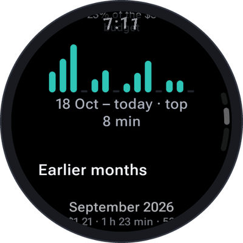
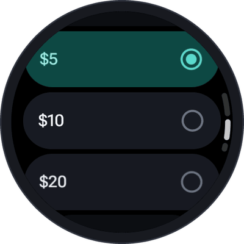
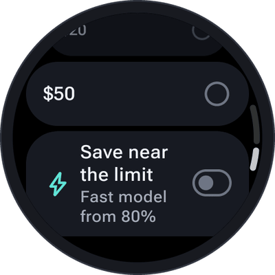

# Costs and budget

SayOVA itself is a one-time purchase. Talking is billed by your provider, with your own key, for what you
actually use — and SayOVA shows you exactly what that is, so there are no surprises.

## What a conversation costs

| Provider | Model in SayOVA | Approximate cost |
| --- | --- | --- |
| Google | *Fast* (`gemini-3.8-live`) | 1–2 ¢ per minute |
| Google | *Thorough* (`gemini-3.8-live-extended-thinking`) | 1–2 ¢ per minute, plus about ½ ¢ of thinking for a hard question |
| OpenAI | *Fast* (`gpt-realtime-2.1-mini`) | 2–5 ¢ per minute |
| OpenAI | *Best* (`gpt-realtime-2.1`) | 6–11 ¢ per minute |

A typical question with a short answer costs well under a cent with Gemini. Longer conversations cost
a little more per minute, because the model hears the whole conversation so far with every answer.
Listening to a [voice sample](Settings#voice) costs less than 1 ¢, once per voice.

## During a conversation

With **Settings → Show cost** on (the default), the running cost appears under the orb next to the time:
*1:24 · ~2 ¢ · Wi-Fi*. The history shows each conversation's cost too.

## Usage statistics

<table>
  <tr>
    <td align="center" width="33%"></td>
    <td align="center" width="33%"></td>
    <td align="center" width="33%"></td>
  </tr>
</table>

Open them with a tap on the line under the orb on the home screen, or under **Settings → Usage & costs**:

- **This month** — cost, talk time and number of conversations, and with a budget, how much of it is used.
- **The last two weeks** — talk time per day as a chart.
- **Earlier months** — each month's cost and talk time.
- **All time** — everything together, with the average per conversation and per minute.

The statistics are kept on the watch apart from the history: they stay complete when the history is
short or switched off, and contain nothing of what was said — only dates, time and cost.

> **Note:** all amounts are **estimates** from the usage your provider reports and its published prices, in US
> dollars. Your provider's bill is what counts — check it at
> [Google AI Studio](https://aistudio.google.com) or the [OpenAI platform](https://platform.openai.com/usage).

## The monthly budget

<table>
  <tr>
    <td align="center" width="50%"></td>
    <td align="center" width="50%"></td>
  </tr>
</table>

Set one under **Settings → Monthly budget**: off, $1, $2, $5, $10, $20 or $50. Then:

| When | What happens |
| --- | --- |
| **From 80%** | The home screen shows the month's cost against the budget in amber, the statistics show a bar, and a short note appears if you cross the mark during a conversation. |
| **Save near the limit** on | From 80% on, SayOVA talks with the cheaper *Fast* model (shown as *Near the budget · Fast*). |
| **Budget reached** | The line turns coral. Before every new conversation SayOVA asks: *"$5.02 of $5 spent this month. Talk anyway?"* — a running conversation carries on. |

The budget starts again on the first of every month. It is a reminder, not a hard stop — for a hard
limit, set one at your provider as well ([API keys](API-keys)).

## On the watch face

SayOVA's [complication](Tile-complication-and-shortcuts#complication) can show the month's cost against
your budget as a ring or bar, in the watch-face slots that show a value.
