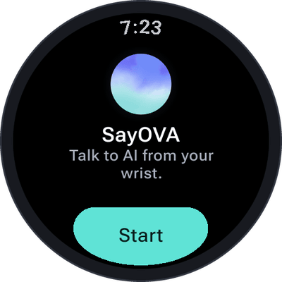
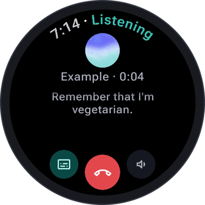
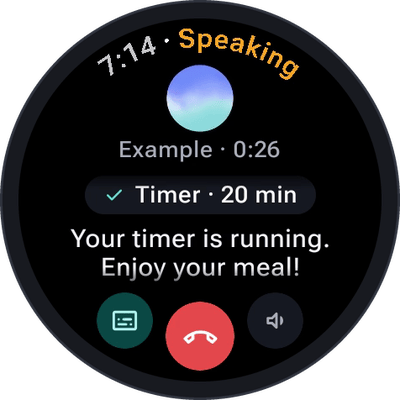
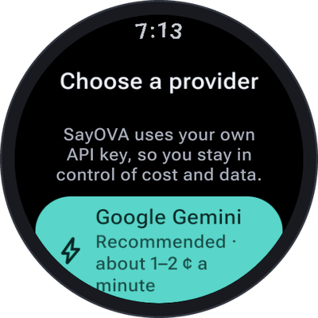
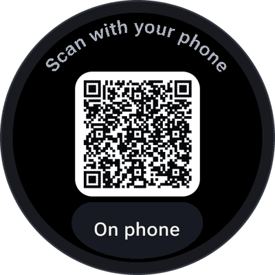
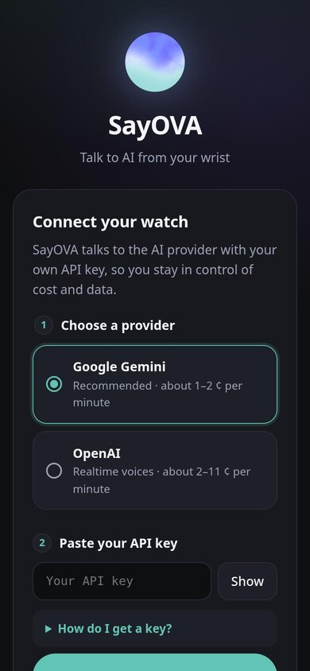
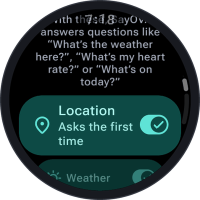
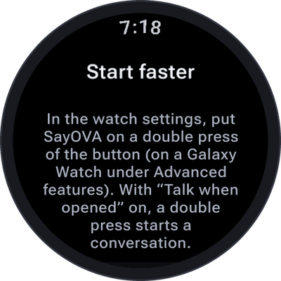
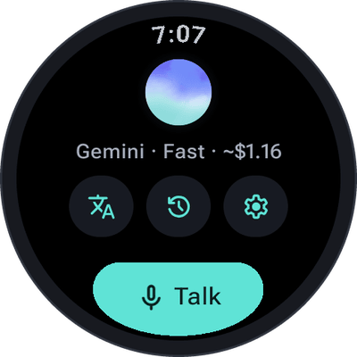

# Getting started

From installing SayOVA to your first conversation takes about five minutes. You need your watch, your
phone (for one QR-code scan) and an API key — if you don't have one yet, [API keys](API-keys) shows how
to get one in two minutes. You can also get it during step 4: the page on your phone links straight to
Google AI Studio and OpenAI.

## 1. Install SayOVA

Install SayOVA from [Google Play](https://play.google.com/store/apps/details?id=net.devemperor.sayova),
either from the Play Store on the watch or from the Play Store on your phone (choose your watch as the
device). SayOVA runs on every watch with **Wear OS 3 or newer** and a microphone.

## 2. Hear it first: the sample conversation

<table>
  <tr>
    <td align="center" width="33%"></td>
    <td align="center" width="33%"></td>
    <td align="center" width="33%"></td>
  </tr>
</table>

Open SayOVA and tap **Start**. Before you set anything up, SayOVA plays a short **sample
conversation** in your language — both sides spoken, SayOVA in its real voice, with the transcript
running along. It needs no key and no network, and costs nothing. You will see SayOVA remember a fact
and set a timer, just as it does in a real conversation.

When the sample is over, a short **tour** points out the four controls of a conversation:

| Control | What it does |
| --- | --- |
| **The orb** | Interrupt SayOVA any time: just start talking, or tap the orb. |
| **Text button** (left) | Shows or hides the text. |
| **Sound button** (right) | Tap for silence. Hold it, or turn the bezel, for the volume. |
| **Red button** (middle) | Hangs up. Conversations go to the history. |

Tap anywhere to go to the next tip. The last one hangs up and takes you on to the setup.

## 3. Allow the microphone

SayOVA asks for the microphone. It is only used while a conversation is open, and nothing is recorded
or kept as audio. If you said no by mistake, the
screen offers a button to the app's settings to allow it there.

## 4. Choose a provider and connect your key

<table>
  <tr>
    <td align="center" width="33%"></td>
    <td align="center" width="33%"></td>
    <td align="center" width="33%"></td>
  </tr>
</table>

1. **Choose a provider.** *Google Gemini* is recommended: it is the cheapest (about 1–2 ¢ a minute),
   sounds very natural and answers fast. *OpenAI* costs about 2–11 ¢ a minute. You can add the other
   one later and switch at any time — see [API keys](API-keys).
2. **Scan the QR code** with your phone's camera. If scanning is awkward, tap **On phone**: the page
   opens on the phone that is paired with the watch.
3. On the page that opens, **paste your API key** and tap **Send to watch**. The key is encrypted in
   your phone's browser for this one watch; the server in between only passes on data it cannot read
   and deletes it within ten minutes. Don't have a key yet? Open **How do I get a key?** on the page.
4. **Compare the code.** The watch and the page now show the same short code. If they match, tap the
   check mark on the watch (**Matches**). This makes sure the key came from your phone and nobody else's.
5. SayOVA **checks the key** with your provider and shows **Connected**. The key is stored encrypted on
   the watch only. Tap **Start**.

> **Note:** a code is valid for ten minutes and only once. If it expired, go back on the watch and choose the
> provider again for a fresh one.

## 5. Choose the watch features

Next, SayOVA lists its [watch features](Watch-features): location, weather, heart rate, steps,
calendar, air pressure, alarms, music, calls and contacts, apps, notifications and preparing things on
your phone. All of them are on; switch off whatever you don't want SayOVA to use.

Nothing is read yet. A feature is only used when your question needs it, and the first time it does,
the watch asks for its permission. You can also tap **Allow now** to grant them all at once.

 

## 6. Start faster

The fastest way to talk to SayOVA is a **double press of the watch's button**. The screen explains how to
set it up in the watch's own settings, and **Set up the button** takes you there — on a Galaxy Watch
straight to the double-press page (*Advanced features → Double press*), on other watches to their
button settings. Choose SayOVA as the app for a double press, then turn on **Talk when opened** here as well, and a double
press goes straight into a conversation. More ways to start: [Tile, complication and
shortcuts](Tile-complication-and-shortcuts).

 

## 7. The home screen

A last short tour shows you around the home screen:

- **The orb** — tap and talk. SayOVA searches the web, sets timers and alarms, takes notes and
  remembers what you ask it to.
- **The line under it** — the provider, model and what you spent this month. Tap it for the
  [statistics](Costs-and-budget).
- **Interpreter** (left) — pick two languages and hold the watch between you. See [Interpreter](Interpreter).
- **History** (middle) — read, continue or send conversations to your phone. See [History](History).
- **Settings** (right) — voice, personality, memory, watch features, budget and more. See [Settings](Settings).
- **Talk** — starts a conversation, just like the orb.

 

## 8. Your first conversation

Tap **Talk** and just speak — SayOVA starts listening the moment you tap, even while it is still
connecting. Some things to try:

- *"What can you do?"*
- *"What's the weather like this afternoon?"*
- *"Set a timer for ten minutes."*
- *"Remember that I'm allergic to nuts."*
- *"Explain how a rainbow forms — briefly."* — and interrupt it halfway with *"Wait, why is the sky blue?"*
- *"Text Anna that I'm on my way."*

Everything about talking to SayOVA is on the next page: [Conversations](Conversations).
