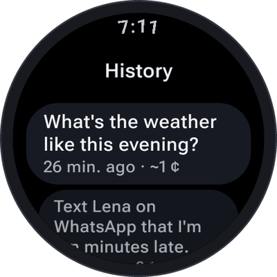

# History

Every conversation is saved in the history **on the watch** — to read again, to continue, or to send to
your phone. It is never uploaded and never backed up to the cloud.

<table>
  <tr>
    <td align="center" width="33%"></td>
    <td align="center" width="33%"></td>
    <td align="center" width="33%"></td>
  </tr>
</table>

## The list

Open **History** from the home screen (the middle button). Every conversation shows the first thing you
said as its title, when it was and what it cost — newest first.

## A conversation

Tap one to read it: your words, SayOVA's answers, and what it did along the way (✓ *Weather · 9 °C, light
rain*, ✎ for a saved note). An answer you interrupted ends where you cut it off — that is what you heard.

At the top:

- **Continue** — picks the conversation up where it ended. SayOVA remembers what was said and you carry
  on talking.

At the end:

- **Send to phone** — opens the conversation as plain text on your phone, with **Share** (any app:
  messengers, notes, mail) and **Copy**. The text travels inside the link, never through a server.
- **Report a response** — for an answer that was wrong or offensive: pick the answer, and an e-mail
  to the developer opens on your phone with it filled in. You decide whether to send it.
- **Delete** — removes the conversation, after asking.

## Several at once

**Hold a conversation** in the list to start selecting, then tap others to add them. You can then
**Send to phone** all of them as one text, or **Delete selected**. *Cancel selection* ends it.

## How long conversations are kept

**Settings → Keep history**:

| Option | |
| --- | --- |
| **Don't save** | Conversations are not saved at all (the conversation screen shows *Ended* instead of *Saved*). |
| **7 days** | Older conversations are deleted. |
| **30 days** | The default. |
| **Forever** | Nothing is deleted automatically. |

**Settings → Delete all history** deletes every conversation at once.

The [usage statistics](Costs-and-budget) are kept separately and stay complete, even when the history is
short or off — they contain only time and cost, nothing of what was said.

## Notes

Notes you dictate — *"Note: buy oat milk"* — are part of the conversation they were made in, marked ✎.
See [Timers, alarms and notes](Timers-alarms-and-notes#notes).
