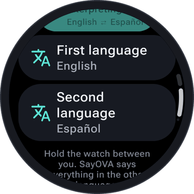
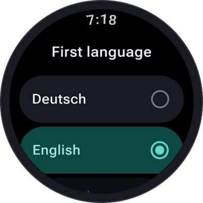

Two people, two languages, one watch. In interpreter mode SayOVA doesn't answer — it **says everything
in the other language**: what you say in yours, it repeats in theirs, and what they answer, it repeats
in yours. Both sides appear as text, so you can read along.

<table>
  <tr>
    <td align="center" width="33%"></td>
    <td align="center" width="33%"></td>
    <td align="center" width="33%"></td>
  </tr>
</table>

## Using it

1. On the home screen, tap the **interpreter** button (left, the translate icon).
2. Check the two languages. Tap **First language** or **Second language** to change one.
3. Tap **Start interpreting** and **hold the watch between you** — on your wrist, arm stretched out a
   little, or take it off and put it on the table.
4. Take turns speaking. SayOVA recognises which of the two languages it hears and says it in the other.
5. Hang up with the red button as usual.

The language pair is remembered for next time. Until you choose, it is your watch's language and
English (or English and Spanish on an English watch).

Under the orb, the language pair takes the place of the network: *0:42 · EN ⇄ ES · ~1 ¢*.

## Languages

21 languages, in any pair:

| | | |
| --- | --- | --- |
| Arabic (العربية) | Hindi (हिन्दी) | Russian (Русский) |
| Chinese (中文) | Indonesian (Bahasa Indonesia) | Spanish (Español) |
| Dutch (Nederlands) | Italian (Italiano) | Swedish (Svenska) |
| English | Japanese (日本語) | Thai (ไทย) |
| French (Français) | Korean (한국어) | Turkish (Türkçe) |
| German (Deutsch) | Polish (Polski) | Ukrainian (Українська) |
| Greek (Ελληνικά) | Portuguese (Português) | Vietnamese (Tiếng Việt) |

## Tips

- **Speak in short pieces** — a sentence or two — and pause. SayOVA starts as soon as you stop, and
  short turns make the conversation flow.
- In a **noisy place**, switch on [push-to-talk](Conversations#muting-the-microphone-and-push-to-talk)
  and tap the orb for each turn.
- With the **sound off**, SayOVA only shows the translation as text — handy for reading it to someone
  or showing them the watch.
- Interpreting costs the same per minute as a normal conversation. The *Fast* models are quick enough
  and the cheapest.
- Interpreted conversations go to the [history](History) like any other, with both languages.
