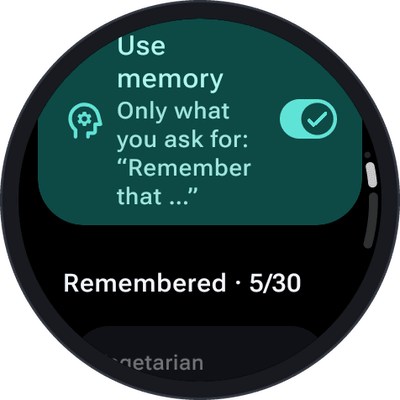

SayOVA can remember things about you across conversations — but **only what you ask it to**. It doesn't
quietly collect facts from what you say; you decide what it knows, and you can see and delete every
single fact.

<table>
  <tr>
    <td align="center" width="33%"></td>
    <td align="center" width="33%"></td>
    <td align="center" width="33%"></td>
  </tr>
</table>

## Remembering

> *"Remember that I'm vegetarian."* · *"Remember that my sister's birthday is on 3 May."* ·
> *"Keep in mind that I work night shifts."* · *"Remember that I prefer metric units."*

SayOVA confirms with **Remembered** and a note in the transcript (*Remembered: Vegetarian*). From now on
every conversation knows: ask *"What could I cook tonight?"* and it suggests something without meat.

When something changes, just say so — *"I moved to Munich"* — and SayOVA replaces the old fact instead of
keeping both.

## Forgetting

> *"Forget that I'm vegetarian."* · *"Forget where I live."* · *"What do you know about me?"*

SayOVA confirms with **Forgotten**. Ask what it knows, and it tells you.

## Settings → Memory

- **Use memory** — on by default. Switched off, SayOVA neither remembers nor uses any facts; the facts
  already saved are kept until you turn it on again or delete them.
- **Remembered · 5/30** — every fact, oldest first. Tap one to **forget** it.
- **Forget everything** — deletes all facts at once.

SayOVA keeps up to **30 facts** of up to 150 characters each. When the memory is full, SayOVA asks you to
let go of one first.

 

## Where the facts are

The facts are stored **only on the watch**, never in a cloud and never in a backup. To be useful, they
are given to your AI provider at the start of every conversation, as part of SayOVA's instructions — so
don't ask SayOVA to remember anything you wouldn't tell your provider. Deleting a fact on the watch
removes it from every later conversation.

See also [Privacy and security](Privacy-and-security).
