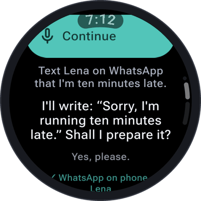
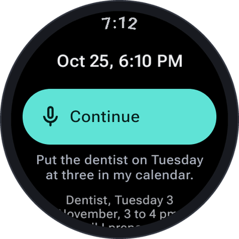

Some things are better finished on the phone: a message you want to send from your own account, an
appointment for your calendar, a route to follow. SayOVA **prepares them on your phone** — filled in,
one tap away — and you send, add or start them there. **SayOVA itself never sends anything in your name.**

This is the *Prepare on phone* [watch feature](Watch-features). It needs no permission, only a phone
paired with the watch.

<table>
  <tr>
    <td align="center" width="50%"></td>
    <td align="center" width="50%"></td>
  </tr>
</table>

## Messages

> *"Text Lena on WhatsApp that I'm ten minutes late."* · *"Send Tom an SMS: see you at eight."* ·
> *"E-mail anna@example.com that the report is ready."* · *"Write to the family group on Signal: dinner's at seven."*

1. SayOVA **reads the message back** and says whom it is for: *"I'll write: 'Sorry, I'm running ten
   minutes late.' Shall I prepare it?"*
2. Change it if you like — *"Make it fifteen"* — or say **yes**.
3. The message **opens on your phone**, ready to send:
   - **WhatsApp** — the chat with that person, the text in the input field.
   - **SMS** — your messages app, with number and text.
   - **E-mail** — your mail app, with address, subject and text.
   - **Any other messenger** (Signal, Telegram, Threema, …) — a page with the text and **Share**, to
     pick the app and the chat, or **Copy**.
4. Tap **send** on the phone.

**Whom to:** with the [Calls and contacts](Watch-features#calls-and-contacts) feature on, SayOVA looks
the number up in your contacts (and completes it with your country code). Without it, the chat or
contact picker opens on the phone and you choose there.

## Calendar events

> *"Put the dentist on Tuesday at three in my calendar."* · *"Add a team lunch tomorrow from 12 to 1 at
> Luigi's."* · *"Block Friday as holiday."*

SayOVA repeats the event — title, day, time, place — and after your yes, a page opens on your phone
with the event and **Add to calendar**. That hands it to **your own calendar app** (Google Calendar,
Samsung Calendar, Proton, Etar, …) as a standard calendar file, filled in, for you to save — if the
phone asks, open the downloaded file with your calendar app. **Use Google Calendar instead** is there
as well. Without an end time, an event lasts an hour; an event without a time
is all-day.

To ask what is already in your calendar, see [Calendar](Watch-features#calendar).

## Routes and places

> *"Route to the central station."* · *"Show me the way to Hauptstraße 12 in Leipzig."* ·
> *"Find the next petrol station on the map."*

The place opens in **your maps app** on the phone (Google Maps, Organic Maps, OsmAnd, …), where you
start the route — on foot, by car or by bike — with a tap.

## What you see on the watch

While SayOVA prepares something, **Opening on your phone…** shows under the orb, then a note such as
**✓ WhatsApp on phone · Lena**, **✓ Event on phone · Dentist** or **✓ Map on phone · Central station**. SayOVA says that it
is waiting on your phone — never that it was sent.

If the phone can't be reached (Bluetooth off, phone far away), SayOVA tells you; try again when the
phone is back.

## Privacy

The message, event or place goes from the watch to your phone over the watch's connection to it. For
events and other messengers, the content travels **in the link itself** (after the `#`, which browsers
never send to a server): the page on `pair.sayova.app` turns it into the calendar file or the share
sheet right on your phone. Nothing of it is stored anywhere. See [Privacy and security](Privacy-and-security).
