# Settings

Open the settings from the home screen (the right-hand button). This page goes through them from top
to bottom.

<table>
  <tr>
    <td align="center" width="25%">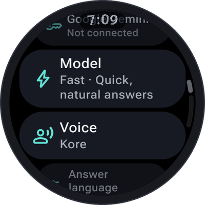</td>
    <td align="center" width="25%">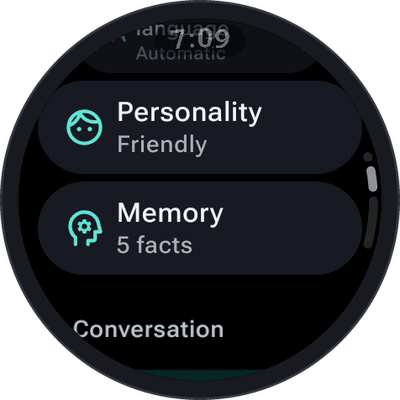</td>
    <td align="center" width="25%">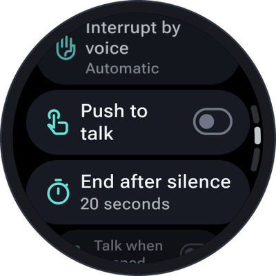</td>
    <td align="center" width="25%">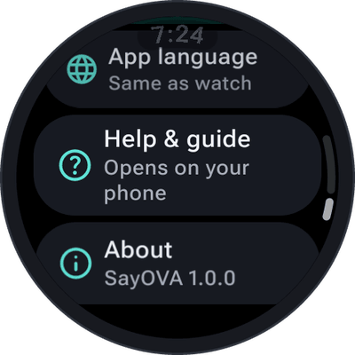</td>
  </tr>
</table>

## Provider

The first line shows your provider and whether its key is on this watch (*Key on this watch* / *Not
connected*). Tap it to switch between Google Gemini and OpenAI, or to connect, replace or remove keys —
see [API keys](API-keys).

## Model

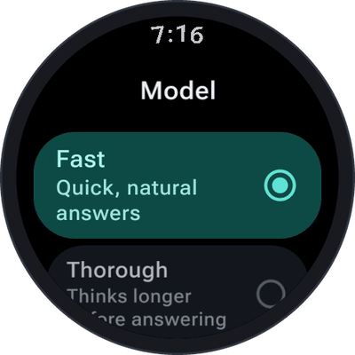

| Provider | Model | |
| --- | --- | --- |
| Gemini | **Fast** (default) | Quick, natural answers. |
| Gemini | **Thorough** | Answers at once, then thinks longer in the background before it gives its considered answer — for tricky questions. The status shows *Thinking* until it has said everything. |
| OpenAI | **Fast** (default) | Quick and affordable. |
| OpenAI | **Best** | OpenAI's strongest voice model, at two to three times the price. |

 

## Voice

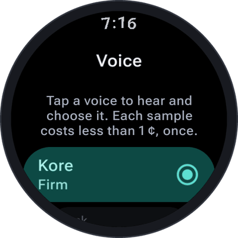

**Tap a voice to hear it** — SayOVA plays a short sample (*"Hi, I'm Kore. This is how I sound when I
answer you."*) and chooses it. Each voice is described in a word: firm, upbeat, bright, warm, … Gemini has
30 voices (default *Kore*), OpenAI 10 (default *Marin*; *Marin* and *Cedar* are recommended). A sample
costs less than 1 ¢, once per voice; after that it is kept on the watch.

 

## Answer language

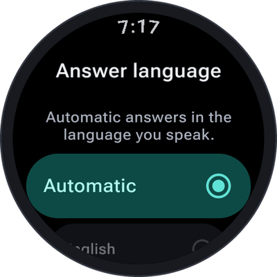

**Automatic** (default) answers in the language you speak — switch language mid-conversation and SayOVA
follows. Or fix one: English, German, French, Spanish, Italian, Portuguese, Dutch, Polish, Turkish or
Japanese. Not the same as the *app language* below, which only changes the screens.

 

## Personality

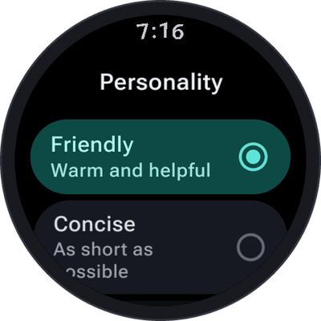

How SayOVA talks — and how much:

| Personality | |
| --- | --- |
| **Friendly** (default) | Warm and helpful. Explains a how or why in four to six sentences. |
| **Concise** | As short as possible — usually one sentence. |
| **Detailed** | Explains with background and examples. |
| **Tutor** | Explains step by step. |
| **Language partner** | A practice conversation in the language you're learning, with short turns. |
| **Custom** | Your own instruction — *"How should SayOVA behave?"* Type or dictate it. |

 

## Memory

What SayOVA remembers about you: on or off, every fact, and *Forget everything*. See [Memory](Memory).

## Conversation

- **Web search** — on by default. Lets SayOVA look up anything current. See
  [Web search](Timers-alarms-and-notes#web-search).
- **Watch features** — which of the watch's sensors and data SayOVA may use, and their permissions
  (*7 of 12 on*). See [Watch features](Watch-features).
- **Interrupt by voice** — *Automatic*, *Open microphone* or *Tap only*. See
  [Interrupting](Conversations#interrupting).
- **Push to talk** — the microphone stays closed until you tap the orb. See
  [Conversations](Conversations#muting-the-microphone-and-push-to-talk).
- **End after silence** — hang up after 10, 20 (default), 30 or 60 seconds without anyone talking, or never.
- **Talk when opened** — opening SayOVA starts a conversation straight away. Together with a double press
  of the watch's button, the fastest way to talk. See [Shortcuts](Tile-complication-and-shortcuts).

  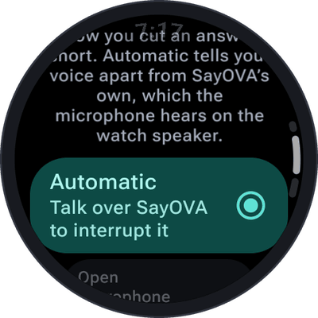
  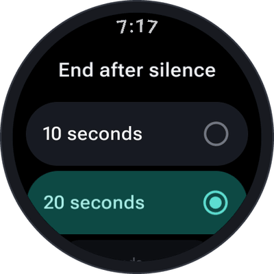

## Costs

- **Usage & costs** — this month's cost and talk time; tap for the statistics.
- **Monthly budget** — off, or $1 to $50, with **Save near the limit**.
- **Show cost** — the running cost under the orb during a conversation (on by default).

All in [Costs and budget](Costs-and-budget).

  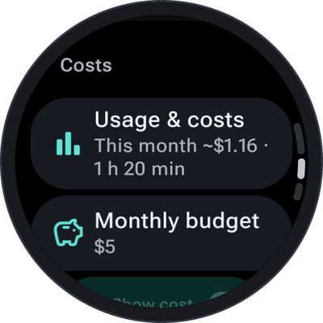

## Privacy

- **Keep history** — don't save, 7 days, 30 days (default) or forever.
- **Delete all history** — deletes every conversation, after asking.

See [History](History).

  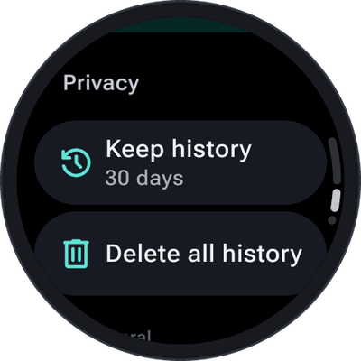
  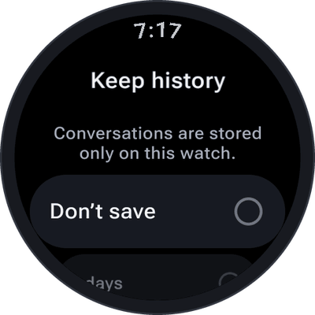

## General

- **Vibration** — a short vibration when SayOVA starts listening and when it does something. On by default.
- **App language** — the language of SayOVA's screens: *Same as watch* or one of English, German, Spanish,
  French, Italian, Japanese, Korean, Dutch, Polish, Portuguese, Swedish, Turkish and Chinese. On watches
  with Wear OS 4 or newer.
- **Help & guide** — opens this guide on your phone.
- **About** — the version, a short privacy summary, and links (opened on your phone) to the privacy
  policy, the source code and the open-source licences, and the contact address.

  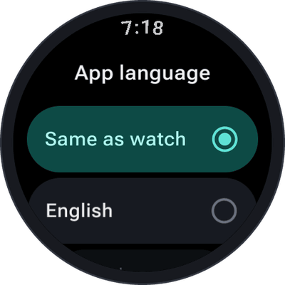
  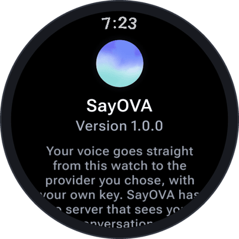

