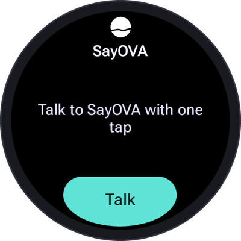

# Tile, complication and shortcuts

The quicker you can start talking, the more often SayOVA is worth it. There are four ways to start a
conversation without opening the app first.

## Double press of the button — the fastest

Most watches let you choose an app for a **double press of the side button**.

1. In the **watch's settings**, choose SayOVA for the double press. On a Galaxy Watch it is under
   *Advanced features → Double press*; on other watches under *Gestures* or *Buttons*, where the watch
   offers it. During SayOVA's introduction, **Set up the button** opens the right page.
2. In SayOVA, turn on **Settings → Talk when opened**.

Now a double press goes straight into a conversation — press, and talk.

 

## The tile

Swipe left from the watch face to the tiles. To add SayOVA's: swipe to the end, tap **+ Add tile** (or
hold a tile and choose *Add*), and pick **SayOVA**. The tile shows your last conversation's title and a
**Talk** button that starts a new conversation.

 

## Complication

Add SayOVA to your watch face: hold the watch face, tap **Customise** (or the pencil), choose a
complication slot and pick **SayOVA**. A tap on it starts a conversation.

SayOVA fits every kind of slot:

| Slot | Shows |
| --- | --- |
| Small round slot (short text) | *Talk* with SayOVA's icon |
| Wide slot (long text) | *Talk to SayOVA* with the orb |
| Ring or arc (ranged value, goal) | This month's cost against your [budget](Costs-and-budget), with *Talk* |
| Segments (Wear OS 4+) | Spent in teal against what is left |
| Icon or photo slot | SayOVA's icon or orb |

Without a budget the ring stays empty and simply works as a button.

## The app icon and the home screen

Of course you can also open SayOVA from the app list and tap **Talk** — or the orb. With *Talk when
opened* on, opening the app is enough.

## While a conversation runs

A running conversation shows as an **ongoing activity**: an icon on the watch face and an entry at the
top of the app list. Tap it to get back to the conversation, for example after the screen went off.
