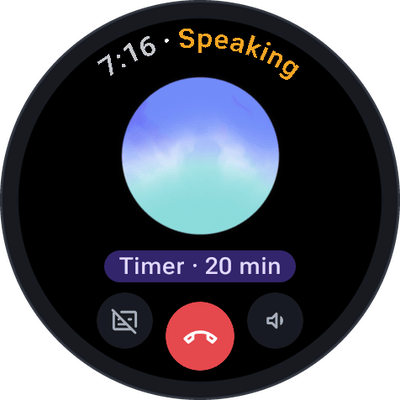
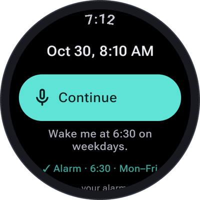
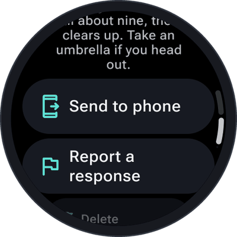

Some things SayOVA can always do, without any permission and without switching anything on: timers,
alarms, notes, the time and the battery, and — if you like — searching the web. For everything that
reads the watch's sensors or your data, see [Watch features](Watch-features).

## Timers

> *"Set a timer for 12 minutes."* · *"Tea timer, four minutes."* · *"Timer for an hour and a half."*

SayOVA starts the timer in the watch's own clock app, so it rings and shows like any other timer — even
after the conversation has ended. You see **Timer · 12 min** under the orb and in the transcript.
Timers can run from one second to 24 hours, and a name (*"tea"*) is shown in the clock app.

 

## Alarms

> *"Wake me at 6:30."* · *"Set an alarm for 7 tomorrow."* · *"Alarm at 6:30 on weekdays."* ·
> *"Every Saturday at 9, alarm called swimming."*

An alarm rings at the next time it is due. Say the days for an alarm that repeats every week — weekdays,
weekends or any days you like. The alarm is set in the watch's clock app and shows as **Alarm · 6:30 ·
Mon–Fri**.

### Stopping a timer, turning off an alarm

> *"Show my timers."* · *"Open my alarms."*

Android lets apps start timers and set alarms, but not look at, pause, change or delete them. So for
that, SayOVA **opens the clock app** on its timers or alarms page, where you do it with a tap. The
conversation ends for it. SayOVA tells you so instead of pretending it turned something off.

To know when your next alarm rings, ask *"When does my alarm ring?"* — that is the
[Next alarm](Watch-features#next-alarm) watch feature.

 

## Notes

> *"Note: buy oat milk and basil."* · *"Make a note that the parking spot is on level 3, row F."*

SayOVA saves the note in the **[history](History)**, marked with ✎ in the conversation, so you find it
again with the conversation it belongs to. Send it to your phone from there to keep it in any notes app.

## Time, date and battery

> *"What's the time in Tokyo?"* · *"What's today's date?"* · *"How much battery is left?"*

SayOVA knows the watch's time, date, time zone and battery level.

## Web search

> *"What's the latest news on the Artemis mission?"* · *"Is the hardware store open on Sunday?"* ·
> *"Who won the match last night?"*

For anything current — news, opening hours, prices, results, events — SayOVA searches the web and answers
with what it found. You see **Searching the web…** while it does, and **Searched the web** in the
transcript. With Gemini this is Google Search; with OpenAI a separate web search request with your key,
which adds a little to the cost.

Web search is on by default. Turn it off under **Settings → Web search**; SayOVA then answers only from
what the model knows, which may be out of date for recent events.

## Ending the conversation

> *"Thanks, bye!"* · *"That's all."* · *"Stop."*

Say goodbye and SayOVA hangs up by itself after a short farewell.
