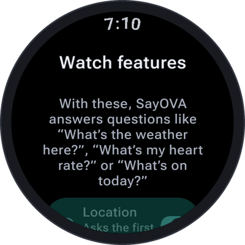
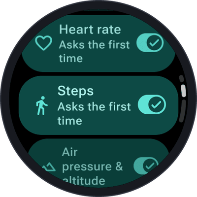
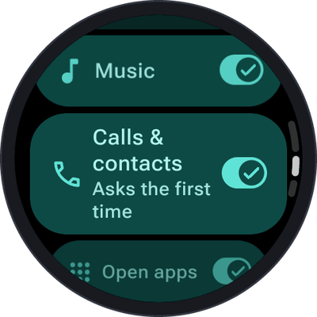
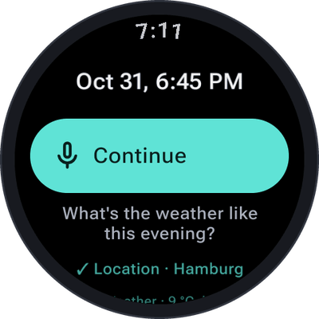

# Watch features

With its watch features, SayOVA uses the watch it runs on: where you are, the weather there, your heart
rate, your steps, your calendar and more. Each one is used **only when your question needs it**, and the
first time it does, the watch asks for its permission — once.

<table>
  <tr>
    <td align="center" width="25%"></td>
    <td align="center" width="25%"></td>
    <td align="center" width="25%"></td>
    <td align="center" width="25%"></td>
  </tr>
</table>

## Turning features on and off

Open **Settings → Watch features**. Every feature has a switch and shows where its permission stands:

| Shown | Meaning |
| --- | --- |
| **Allowed** | The permission is granted; SayOVA can use the feature right away. |
| **Asks the first time** | The watch asks for the permission when SayOVA first needs it. |
| **Not allowed** | You said no. SayOVA tells you when a question needs it; allow it again with **Allow in watch settings**. |
| **Switch on in the watch settings** | The feature needs a special access you grant in the watch's own settings (notifications). |
| **Not available on this watch** | The watch lacks the sensor or app (for example no barometer). |

**Allow now** asks for all missing permissions at once. A switched-off feature is not offered to the AI
at all — SayOVA doesn't know it exists and won't try.

## While a feature is in use

Like Android's own privacy indicators, a feature shows **its icon under the orb while SayOVA uses it**,
together with a short note — *Finding your location…*, *Measuring heart rate…* — and the result stays in
the transcript with a check mark: **✓ Location · Hamburg**, **✓ Weather · 9 °C, light rain**.

What SayOVA reads goes to your AI provider **only in the conversation where you ask for it** — never in
the background, never between conversations.

 

## The features

### Location

> *"Where am I?"* · *"Is there a pharmacy nearby?"* · *"How far is it to the station?"*

Where the watch is: coordinates, accuracy and — when known — the place name. For places nearby SayOVA
then searches the web. **Permission:** location (precise or approximate; approximate is enough for most
questions).

### Weather

> *"What's the weather here?"* · *"Will it rain this afternoon?"* · *"How cold will it be in Vienna tomorrow?"*

The weather now and the forecast for today and tomorrow, from the
[Norwegian Meteorological Institute](https://api.met.no) — for where you are, or for any other place you
name. For where you are, it needs the **location** permission; for another place, none. MET Norway
receives the place's coordinates, rounded, and nothing else.

### Heart rate

> *"What's my heart rate?"* · *"Measure my pulse."*

SayOVA measures your heart rate **now** with the watch's sensor. It takes up to half a minute: keep the
watch on and hold still — SayOVA tells you so first. **Permission:** heart rate (on older watches *body
sensors*).

### Steps

> *"How many steps today?"* · *"Have I reached ten thousand steps?"*

Today's step count from the watch. **Permission:** physical activity.

### Calendar

> *"What's on today?"* · *"When is my next meeting?"* · *"Am I free tomorrow afternoon?"*

Your events that have not ended yet — today or up to two weeks ahead — with title, time and place, from
the calendars synced to the watch. **Permission:** calendar. To *add* an event, see
[Prepare on phone](Prepare-on-phone).

### Air pressure and altitude

> *"What's the air pressure?"* · *"How high up am I?"*

The barometer's air pressure in hPa and the altitude it suggests. Only on watches with a barometer.
No permission needed.

### Next alarm

> *"When does my alarm ring?"* · *"Have I set an alarm for tomorrow?"*

When the next alarm rings, or that none is set. No permission needed. Setting alarms needs no feature at
all — see [Timers, alarms and notes](Timers-alarms-and-notes).

### Music

> *"Pause the music."* · *"Next song."* · *"Play."* · *"Previous track."*

Controls what is playing on the watch — music, podcasts, audiobooks: play, pause, next, previous. After
*play*, SayOVA hangs up so you can listen. No permission needed.

### Calls and contacts

> *"Call Lena."* · *"What's Tom's number?"* · *"Call my dentist."*

SayOVA looks the name up in the contacts on the watch, **tells you whom and which number it will call,
and calls only after your yes**. The call starts when the conversation has ended. On a watch without
LTE it goes through your phone, like any call from the watch. **Permissions:** contacts and phone calls.

### Open apps

> *"Open the flashlight."* · *"Start Samsung Health."* · *"Open the stopwatch."*

Opens an app on the watch by its name; the conversation ends for it. If no app matches, SayOVA lists the
ones it found. No permission needed.

### Notifications

> *"Anything new?"* · *"Read my messages."* · *"What did Anna write?"*

Reads the notifications on the watch, newest first, briefly — not word for word unless you ask.
**Access:** this needs *notification access*, which Android only grants in the watch's own settings:
**Allow in watch settings** under **Settings → Watch features** takes you there; switch SayOVA on.

### Prepare on phone

> *"Text Lena on WhatsApp that I'm late."* · *"Put the dentist on Tuesday at three in my calendar."* ·
> *"Route to the station."*

Messages, e-mails, calendar events and routes, prepared on your phone for you to send or start there.
It has a page of its own: [Prepare on phone](Prepare-on-phone).

## Permissions at a glance

| Feature | Permission | Used for |
| --- | --- | --- |
| Location | Location | Where you are, nearby places, the weather here |
| Weather | (Location, only for where you are) | Weather now, today and tomorrow |
| Heart rate | Heart rate / body sensors | One measurement, now |
| Steps | Physical activity | Today's count |
| Calendar | Calendar | Events from today up to two weeks |
| Air pressure & altitude | — | The barometer |
| Next alarm | — | The next alarm's time |
| Music | — | Play, pause, next, previous |
| Calls & contacts | Contacts, phone calls | Looking up numbers, calling after your yes |
| Open apps | — | Opening an app by name |
| Notifications | Notification access (watch settings) | Reading the current notifications |
| Prepare on phone | — | Opening links on the paired phone |

Changed your mind? Revoke any permission in the watch's settings under *Apps → SayOVA → Permissions*,
or switch the feature off in SayOVA.
